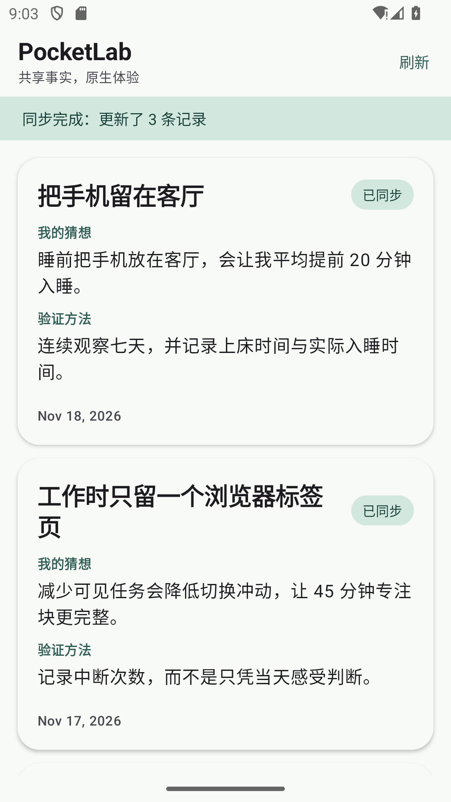
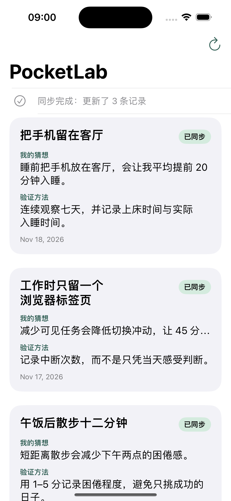

# Android Compose + SwiftUI：UI 不共享也能合作愉快

> 面向读者：熟悉 Android Compose、准备把第一个 KMP 功能接入 iOS 的 Kotlin 开发者
>
> 技术核对与实验验证日期：2026-11-19
>
> 实验版本：Kotlin 2.4.21、AGP 8.13.2、Compose BOM 2026.06.01、Lifecycle 2.10.0、Xcode 26.5、Swift 6.3.2

PocketLab 的共享层已经很像一个正经 App 了：

```text
Ktor / Demo Remote → Refresh UseCase → SQLDelight → Flow<List<ExperimentRecord>>
```

它能离线读取，能事务合并，能保护待上传记录，也能把 Kotlin `Job` 的取消信号接到 Swift `Task`。

可用户看不到这些。

某天产品同学看着命令行里一排绿色的 `BUILD SUCCESSFUL`，问了一个让架构图瞬间失去光环的问题：

> “所以 App 在哪？”

我们终于走到 KMP 最容易引发宗教战争的一站：UI 到底要不要共享？

有人说，既然用了 KMP，就应该把 UI 也复用起来；有人说，iOS 必须 100% SwiftUI，否则就是背叛原生；还有一种更隐蔽的冲动：把一切状态都塞进共享 ViewModel，然后要求两端按同一种方式生活。

这篇文章不选口号。我们先做一个具体、可运行的决策：

- Android 用 Jetpack Compose；
- iOS 用 SwiftUI；
- 数据、同步规则、数据库和 UseCase 共享；
- ViewModel、生命周期、本地化和界面交互留在各自平台；
- 两端读取同一种事实，但使用各自最自然的表达方式。

最后，我们会把同一批 3 条实验记录真正跑在 Android API 34 和 iOS 17.5 模拟器上，而不只是在 Markdown 里画两个手机框。

## 先说结论：KMP 共享的是能力，不是像素

Kotlin 官方对 KMP 的定义从来不是“必须共享 UI”。你可以只共享业务逻辑，也可以继续向上共享 ViewModel，甚至使用 Compose Multiplatform 共享界面。

问题不在“能不能”，而在“哪一层的变化原因相同”。

PocketLab 当前的边界是：

| 层 | Android | iOS | 是否共享 | 原因 |
|---|---|---|---:|---|
| Experiment 模型 | Kotlin | Kotlin | 是 | 业务语义一致 |
| 刷新、合并与失败分类 | Kotlin | Kotlin | 是 | 规则必须一致 |
| SQLDelight 数据库与 Flow | Kotlin | Kotlin | 是 | 离线事实来源一致 |
| 平台装配 | Application graph | iOS feature factory | 部分 | 资源生命周期不同 |
| ViewModel | AndroidX ViewModel | `@MainActor ObservableObject` | 否 | 生命周期与观察机制不同 |
| 文案与日期 | Android resources / `java.time` | Swift strings / `Date.FormatStyle` | 否 | 本地化与平台习惯不同 |
| UI | Jetpack Compose | SwiftUI | 否 | 组件、导航、交互语义不同 |

这不是“少共享了一点”。它是一种明确的职责划分：

> 共享层负责什么是真的，平台层负责怎样让用户看见、操作和理解它。

## 两套 UI，为什么不会变成两套业务？

因为两端没有各自发明数据流。

```text
                         ┌─────────────────────────────┐
Android Compose ────────>│ Android ViewModel           │
                         │ lifecycle + localized state │
                         └──────────────┬──────────────┘
                                        │
                                        ▼
                         ┌─────────────────────────────┐
                         │ Shared Kotlin core          │
                         │ RefreshUseCase              │
                         │ SQLDelight repository       │
                         │ Flow<ExperimentRecord>      │
                         └──────────────┬──────────────┘
                                        │
                                        ▼
                         ┌─────────────────────────────┐
SwiftUI ────────────────>│ @MainActor Swift ViewModel  │
                         │ Task + AsyncSequence        │
                         └─────────────────────────────┘
```

箭头看起来像 Android 和 iOS 分别拥有一套 ViewModel，但中间只有一套事实：

1. UI 触发 refresh；
2. 共享 `RefreshExperimentsUseCase` 请求远端；
3. UseCase 把结果合并进 SQLDelight；
4. Repository 的 Flow 发出数据库提交后的新快照；
5. 平台 ViewModel 把快照变成平台可观察状态；
6. 原生 UI 重绘。

网络 response 依然不会直接喂给 UI。即使 Android 和 iOS 页面完全不同，它们也不会在离线规则、pending 保护和版本合并上产生分叉。

## 共享 ViewModel 还是平台 ViewModel？这不是非黑即白

2026 年的 Kotlin 文档已经把两条路线都列为合理方案：

- 共享 ViewModel，让 Android 和 iOS 消费同一个状态持有者；
- 平台专用 ViewModel，共享下面的数据与领域层。

PocketLab 这一阶段选择第二条，原因不是“共享 ViewModel 做不到”，而是我们正在学习边界：

### Android ViewModel 天然知道 Android 生命周期

它拥有：

- `viewModelScope`；
- `ViewModelProvider.Factory`；
- configuration change 后的保留行为；
- `collectAsStateWithLifecycle()` 的订阅启停；
- Android resources 到本地化文案的映射。

### Swift ViewModel 天然知道 Swift Concurrency

它拥有：

- `@MainActor`；
- `@Published` 与 `ObservableObject`；
- SwiftUI `.task` 的自动取消；
- `.refreshable` 的 async closure；
- Swift `Date.FormatStyle` 与平台文案。

如果此时强行共享 ViewModel，我们要么让共享对象知道太多平台语义，要么再写一层平台 wrapper。后者不是错，但在只有一个列表功能时，复杂度收益并不划算。

一个实用判断题是：

> 如果两端只想共享业务状态机，且页面结构高度相似，共享 ViewModel 可能很值；如果状态里混入大量导航、权限、系统组件和本地化呈现，平台 ViewModel 往往更诚实。

## Android：让 ViewModel 把数据库 Flow 变成 UI State

Android 端的 `ExperimentListViewModel` 不重新实现同步，它只组合两个来源：

```kotlin
val uiState = combine(
    localStore.observeAll(),
    refreshPhase,
) { experiments, phase ->
    ExperimentListUiState(
        experiments = experiments,
        isRefreshing = phase == RefreshPhase.Refreshing,
        notice = phase.toNotice(),
    )
}.stateIn(
    scope = viewModelScope,
    started = SharingStarted.Eagerly,
    initialValue = ExperimentListUiState(),
)
```

这里有三个边界值得注意。

### 1. ViewModel 不保存第二份业务列表

实验记录来自 `localStore.observeAll()`。Refresh 成功只更新 `refreshPhase` 的提示；真正的列表变化必须经过数据库 Flow。

否则很容易出现两份互相打架的数据：

```text
网络成功 → ViewModel list 先更新
数据库写入失败 → 画面看见了重启后不存在的数据
```

离线优先的 UI 必须尊重事实来源。

### 2. 取消与异常要分开

```kotlin
refreshJob = viewModelScope.launch {
    refreshPhase.value = RefreshPhase.Refreshing
    refreshPhase.value = try {
        when (val result = refreshExperiments.execute()) {
            is RefreshExperimentsResult.Applied ->
                RefreshPhase.Applied(result.changedCount)
            is RefreshExperimentsResult.Failed ->
                RefreshPhase.Failed(result.reason)
        }
    } catch (cancellation: CancellationException) {
        throw cancellation
    } catch (_: Exception) {
        RefreshPhase.Unexpected
    }
}
```

`CancellationException` 仍然是控制流，不应该显示成“同步失败”。这与上一章的 Swift bridge 规则完全一致。

### 3. 稳定错误语义共享，中文文案不共享

共同层返回：

```kotlin
RefreshFailureReason.CONNECTION
```

Android UI 才把它映射为 `R.string.refresh_connection`。将来 iOS 可以使用 String Catalog，Android 可以按 locale 切换 resources，而领域层不需要知道任何中文。

## Compose：生命周期感知不是可选装饰

Activity 中的关键代码很短：

```kotlin
private val viewModel: ExperimentListViewModel by viewModels {
    ExperimentListViewModel.Factory(application.graph)
}

setContent {
    val state by viewModel.uiState.collectAsStateWithLifecycle()
    PocketLabTheme {
        ExperimentListScreen(
            state = state,
            onRefresh = viewModel::refresh,
        )
    }
}
```

为什么不用普通 `collectAsState()`？

因为 UI 是否可见是 Android 生命周期语义。`collectAsStateWithLifecycle()` 会在合适的 Lifecycle state 收集，避免页面已经在后台却继续为每次数据库更新做 Compose 重组。

Compose 页面只接收：

```kotlin
state: ExperimentListUiState
onRefresh: () -> Unit
```

它不认识 Repository、Ktor、SQLDelight，也不自己启动协程。这样 Preview、截图测试和纯 UI 测试都更容易添加。

## iOS：composition root 先把资源所有权说清楚

SwiftUI 页面不能靠手工拼十几个 Kotlin 对象启动。共享模块提供了一个 Apple 专用 composition root：

```kotlin
class IosPocketLabFeature internal constructor(
    val experimentList: IosExperimentListBridge,
    private val databaseHandle: PocketLabDatabaseHandle,
    private val network: PocketLabNetwork?,
) {
    fun close() {
        experimentList.close()
        network?.close()
        databaseHandle.close()
    }
}
```

工厂提供两种明确模式：

```kotlin
IosPocketLabFeatures.demo(databaseName)
IosPocketLabFeatures.live(databaseName, baseUrl)
```

`demo` 使用稳定的共享示例数据源，只服务于学习与 UI 演示；它没有伪装成生产后端。`live` 才创建真实 Darwin Ktor engine。

这组 API 的重点不是少写几行 Swift，而是把资源所有权收成一个句子：

> Swift 创建一个 feature，也负责在同一个边界关闭它。

## Swift ViewModel：把桥接细节挡在 View 后面

iOS ViewModel 是一个主 actor 隔离的原生对象：

```swift
@MainActor
final class ExperimentListViewModel: ObservableObject {
    @Published private(set) var experiments: [ExperimentRecord] = []
    @Published private(set) var isRefreshing = false
    @Published private(set) var notice: String?

    private let feature: IosPocketLabFeature
}
```

观察数据库时，它消费上一章建立的 `AsyncThrowingStream`：

```swift
func observe() async {
    do {
        for try await records in feature.experimentList.experiments() {
            experiments = records.value
        }
    } catch is CancellationError {
        // SwiftUI .task 结束，stream 会取消 Kotlin Job。
    } catch {
        notice = error.localizedDescription
    }
}
```

SwiftUI View 只写平台自己的生命周期语言：

```swift
.task {
    await viewModel.observe()
}
.task {
    await viewModel.refresh()
}
.refreshable {
    await viewModel.refresh()
}
```

页面离开时，`.task` 会被取消；`AsyncStream.onTermination` 再把取消传播到 Kotlin `Job`。这条链现在完整了：

```text
SwiftUI View disappears
→ Swift Task cancelled
→ AsyncStream terminated
→ NativeCancellable.cancel()
→ Kotlin Job cancelled
```

## 真实 App 暴露了一个 type-check 没发现的问题

上一章的 Swift wrapper 通过了命令行严格并发 type-check，但放进真正的 Xcode Swift 6 App target 后，编译器指出：

```text
sending 'records' risks causing data races
```

触发点是：

```swift
continuation.yield(records)
```

原因是 Kotlin/Native 经 Objective-C 导出的 `ExperimentRecord` 没有 Swift `Sendable` 元数据，而 `yield` 是一个发送点。`@preconcurrency import` 能声明“这是旧模块”，却不能凭空证明对象可在线程之间传递。

最终实现没有把整个 target 降成 Swift 5，也没有关闭严格并发检查，而是增加一个刻意命名得很刺眼的窄盒子：

```swift
struct UncheckedSendable<Value>: @unchecked Sendable {
    let value: Value
}
```

然后只在桥上使用：

```swift
continuation.yield(UncheckedSendable(records))
```

`@unchecked` 不是“编译器别烦我”。它背后必须有人工证明：

1. Kotlin bridge 用 `Dispatchers.Main` 调用 Swift callback；
2. Swift ViewModel 被 `@MainActor` 隔离；
3. Kotlin 值不会被两个执行上下文并发修改；
4. 豁免只发生在这一条边界，不扩散到整个项目。

这是为什么真实宿主工程不可替代单文件示例：互操作问题常常只有在完整编译模式、actor 隔离和链接阶段才出现。

## SwiftUI 与 Compose 应该看起来完全一样吗？

不应该。

两端共享的信息结构：

- 标题；
- 假设；
- 验证笔记；
- 更新时间；
- 同步状态；
- 刷新结果。

但它们使用不同的原生表达：

| 语义 | Android Compose | SwiftUI |
|---|---|---|
| 列表 | `LazyColumn` | `List` |
| 下拉刷新 | 可后续接 Material pull refresh | `.refreshable` |
| 空状态 | 自定义 Column + Button | `ContentUnavailableView` |
| 顶部动作 | `TopAppBar` | `toolbar` |
| 日期 | `DateTimeFormatter.ofLocalizedDate` | `Date.FormatStyle` |
| 生命周期 | Android Lifecycle | SwiftUI task lifecycle |
| 文案 | string resources | Swift 本地化资源（当前示例为源码文案） |

如果为了截图像素一致而放弃平台标准组件，我们会得到一种奇怪的结果：代码看起来“统一”，用户却觉得两个平台都不够自然。

共享的是信息架构和业务含义，不是每个圆角的半径。

## Xcode direct integration：让 framework 在编译前出现

实验 iOS App 使用 Kotlin 官方 direct integration 任务。在 Xcode 的 “Compile Sources” 之前运行：

```shell
cd "$SRCROOT/.."
./gradlew :shared:embedAndSignAppleFrameworkForXcode
```

同时：

- `ENABLE_USER_SCRIPT_SANDBOXING = NO`，允许脚本访问 Gradle 工程；
- framework search path 指向 Xcode 当前 build products；
- 链接 `PocketLabShared`；
- 对静态 framework 的 SQLDelight Native 依赖显式添加 `-lsqlite3`。

最后一项是这次真实链接阶段才发现的：静态 KMP framework 内含 SQLiter 调用，但系统 `sqlite3` 不会自动变成 App target 的链接输入。只生成 framework 并不等于最终消费者已经拥有所有原生系统库。

这条问题链非常有代表性：

```text
Kotlin 编译成功
≠ framework 链接成功
≠ Swift 编译成功
≠ App 最终链接成功
≠ 模拟器真实启动成功
```

每个等号都必须由不同证据验证。

## Compose 版本不是“全部选最新”

我们一开始使用了当时最新的 Compose BOM 2026.09.00 和 Lifecycle 2.11.0。Gradle 很快给出 33 条 AAR metadata 错误：依赖要求 `compileSdk 37` 和 AGP 9.1，而当前稳定 KMP 工具链使用 AGP 8.13.2。

错误做法是压制 metadata 检查。

正确做法是把版本看成兼容图：

```text
Kotlin 2.4.21
   ↕
AGP 8.13.2 ↔ Gradle 8.14.4 ↔ compileSdk 36
   ↕
Compose BOM 2026.06.01 + Lifecycle 2.10.0
```

因此实验选择 Compose 1.11 系列的最后稳定检查点，而不是为了版本号新一点，把整个 AGP 主版本升级塞进同一个里程碑。

版本管理的目标不是“全绿最新”，而是：

> 用一组有官方兼容依据、能被完整构建验证的版本完成当前变更。

## 双端真实结果

Android API 34：



iOS 17.5：



两张图有同样的 3 条记录、同步状态和刷新结果，却保持各自平台的排版、列表和交互语言。这正是这次实验要证明的合作方式。

## 验证矩阵：别把截图当测试

截图证明界面真的跑起来了，却不能证明规则都正确。因此本里程碑保留多层门禁：

| 验证层 | 证据 | 本次结果 |
|---|---|---:|
| common 规则 | JVM tests | 37/37 |
| Android KMP host | Android host tests | 37/37 |
| iOS KMP | iOS x64 tests | 42/42 |
| Android ViewModel | JVM unit tests | 2/2 |
| 数据库 schema | SQLDelight migration verifier | 通过 |
| Android 打包 | `assembleDebug` | 13 MB APK |
| iOS 编译 | Xcode Swift 6 build | 通过 |
| iOS 最终链接 | framework + sqlite3 + App | 通过 |
| Android 运行 | Pixel 2 API 34 cold start | 通过 |
| iOS 运行 | iPhone 15 Pro iOS 17.5 | 通过 |

共享模块共执行 116 条目标测试，加上 2 条 Android ViewModel 测试，总计 118 条自动化测试。

注意这个数字不是“有 118 个不同业务场景”。同一条 `commonTest` 会在 JVM、Android Host 和 iOS 上重复执行。它的价值是证明相同规则在不同编译目标与运行时下成立。

## 什么时候应该重新考虑共享 UI 或共享 ViewModel？

当前决定不是永久宪法。出现以下信号时应重新评估：

- 两端页面结构长期高度相似，重复 UI 改动成为主要成本；
- 团队已具备 Compose Multiplatform 经验，并接受 iOS UI 由 Kotlin 团队共同拥有；
- 平台 ViewModel 的状态机出现大量逐行重复，而差异只剩很薄的适配；
- 需要桌面端，且共享 Compose UI 能显著放大收益；
- 可访问性、导航、输入法、系统组件和性能经过真实原型验证；
- iOS 团队对调试、预览、发布与回滚路径有明确所有权。

反过来，以下场景支持继续保留原生 UI：

- 两个平台产品体验差异明显；
- 强依赖平台新组件、权限流或导航生态；
- iOS 团队希望保持 SwiftUI 独立交付；
- 业务规则共享收益已经很高，UI 重复并非主要瓶颈。

专家决策不是永远选同一种方案，而是知道什么证据足以改变方案。

## 给 Android 开发者的迁移翻译

如果你第一次读 SwiftUI，可以先用这些近似关系建立方向感：

| Android 心智模型 | SwiftUI 对照 | 关键差异 |
|---|---|---|
| `ViewModel` | `ObservableObject` / Observation model | 生命周期由创建位置决定 |
| `viewModelScope` | `Task` / `.task` | Task tree 属于 Swift runtime |
| `StateFlow` | `@Published` 或 Observation | 跨 KMP 边界需桥接 |
| `collectAsStateWithLifecycle` | `.task { for await ... }` | 取消机制不同 |
| `stringResource` | Localized String / String Catalog | 资源系统不同 |
| `LazyColumn` | `List` / `LazyVStack` | 样式与行为不同 |
| `DisposableEffect` | `onDisappear` / task cancellation | 不应机械一一翻译 |

这张表只用来找入口，不用来宣称 API 等价。真正需要共享的是语义，不是名称。

## 本篇的工程决策

PocketLab 现在遵守以下约束：

1. commonMain 不引用 Compose、SwiftUI、AndroidX ViewModel 或 Apple UI 类型；
2. 两端 UI 只观察数据库事实来源；
3. 刷新规则、失败分类与事务合并保持共享；
4. ViewModel、生命周期、本地化和日期展示属于平台；
5. Apple composition root 显式拥有并关闭 bridge、network 与 database；
6. Swift 6 严格并发不降级，FFI `Sendable` 豁免只允许出现在经审计的窄边界；
7. Android 与 iOS 必须各自完成真实打包和启动验证。

## 读者挑战

完成配套实验后，尝试这五个改动：

1. 关闭网络或让 demo remote 返回 `CONNECTION`，验证两端仍显示数据库旧数据；
2. 新增一条 `PENDING_UPLOAD` 本地记录，确认两端 badge 都显示“待上传”，但文案由平台决定；
3. 把 Android `collectAsStateWithLifecycle()` 换成无生命周期感知的收集，记录后台行为差异；
4. 注释 iOS `onTermination` 的 token cancel，用测试或日志证明幽灵 collection；
5. 为两端分别增加搜索 UI，但只共享一个过滤 UseCase，再判断 ViewModel 是否开始值得共享。

## 写在最后

我们没有得到“一份 UI 代码跑两端”的漂亮复用率，却得到了一种更重要的复用：

- 同一套离线事实；
- 同一套同步规则；
- 同一套失败语义；
- 同一套可重复测试；
- 两套尊重平台的用户体验。

KMP 最有力量的地方，不是让 Android 和 iOS 失去区别，而是让它们不必在那些本来就不该有区别的地方重复犯错。

下一篇，我们会把测试继续向上推进：共同规则、平台适配、ViewModel、数据库、网络、UI，各自应该由哪一层测试兜底？一次验证，究竟怎样才能让两端都放心？

## 官方资料

- [Kotlin Multiplatform 概览：共享什么由项目决定](https://kotlinlang.org/docs/multiplatform/kmp-overview.html)
- [KMP 与 iOS：共享逻辑、保持原生 UI](https://kotlinlang.org/docs/multiplatform/kmp-for-ios.html)
- [Compose Multiplatform ViewModel：共享与平台专用方案](https://kotlinlang.org/docs/multiplatform/compose-viewmodel.html)
- [Kotlin Multiplatform direct integration](https://kotlinlang.org/docs/multiplatform/multiplatform-direct-integration.html)
- [iOS integration overview](https://kotlinlang.org/docs/multiplatform/multiplatform-ios-integration-overview.html)
- [Android Compose BOM](https://developer.android.com/develop/ui/compose/bom)
- [Compose UI release notes](https://developer.android.com/jetpack/androidx/releases/compose-ui)
- [Lifecycle release notes](https://developer.android.com/jetpack/androidx/releases/lifecycle)
