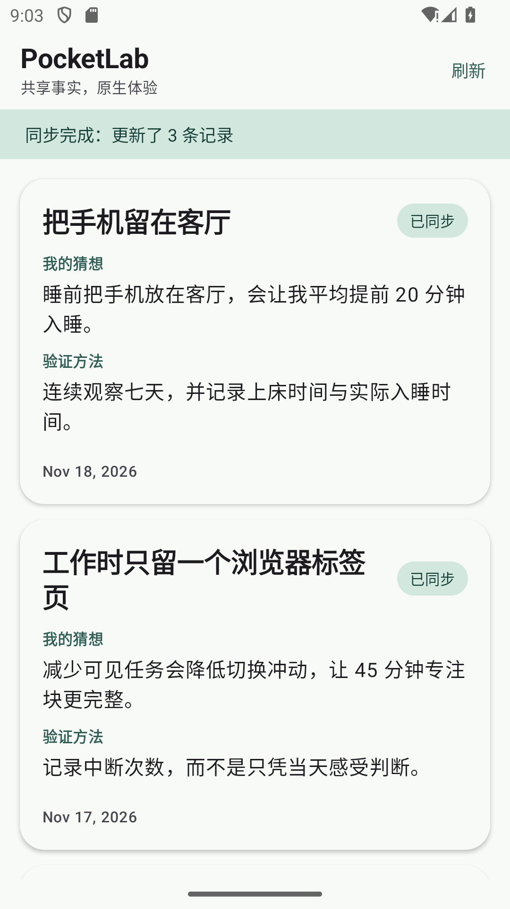
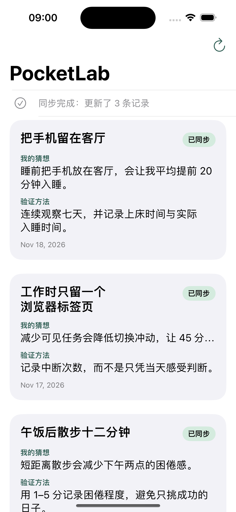

# 实验 09：用 Compose 与 SwiftUI 展示同一份离线事实

## 实验目标

完成本实验后，你应该能用代码和运行证据回答：

1. UI 不共享时，Android 与 iOS 如何避免复制业务规则？
2. 为什么本实验选择平台 ViewModel，而不是立即共享 ViewModel？
3. 数据库 Flow、refresh 状态和本地化文案分别由谁拥有？
4. Android Lifecycle 与 SwiftUI Task 如何管理订阅？
5. Kotlin/Native 对象为什么会触发 Swift 6 `Sendable` 诊断？
6. Xcode direct integration 如何在 Swift 编译前生成 framework？
7. 静态 KMP framework 为什么仍可能要求 App 显式链接系统库？

## 前置条件

- 已完成[实验 08](../08-coroutines-swift-concurrency/README.md)。
- JDK 17、Android SDK Platform 36 与 Xcode 可用。
- 当前实验机为 Intel Mac，因此 Kotlin target 使用 `iosX64`；Apple Silicon 应改为 `iosSimulatorArm64`。
- iOS App 最低版本为 iOS 17。

主工程仍位于：

```text
../02-first-kmp-module
```

## 本次边界

```text
                         commonMain
┌──────────────────────────────────────────────────────────┐
│ ExperimentRecord                                         │
│ RefreshExperimentsUseCase                                │
│ SqlDelightExperimentRepository                           │
│ DemoExperimentRemoteDataSource / Ktor remote             │
└───────────────────────┬──────────────────────────────────┘
                        │ database Flow + stable results
          ┌─────────────┴─────────────┐
          ▼                           ▼
┌──────────────────────┐   ┌──────────────────────────────┐
│ Android ViewModel    │   │ IosExperimentListBridge      │
│ viewModelScope       │   │ callback + NativeCancellable │
└──────────┬───────────┘   └──────────────┬───────────────┘
           ▼                              ▼
┌──────────────────────┐   ┌──────────────────────────────┐
│ Jetpack Compose      │   │ @MainActor Swift ViewModel   │
│ Android resources    │   │ SwiftUI + AsyncSequence      │
└──────────────────────┘   └──────────────────────────────┘
```

共同层不引用 Compose、SwiftUI、AndroidX ViewModel 或 Apple UI 类型。

## 第一步：认识 demo remote 的证明范围

本实验增加：

```text
shared/src/commonMain/kotlin/
  dev/kmpjourney/pocketlab/demo/DemoExperimentRemoteDataSource.kt
```

它延迟 300 ms 后返回 3 条稳定的中文实验记录，目的是让双端 UI 在没有外部服务器时可重复演示。

它不证明：

- 真实 TLS 可用；
- 服务端契约稳定；
- 登录与鉴权完成；
- 生产网络错误已全部覆盖。

`IosPocketLabFeatures.live(...)` 和共享 Ktor 实现仍然保留。不要把 deterministic demo 冒充生产后端。

## 第二步：运行 Android App

Android 壳位于：

```text
../02-first-kmp-module/androidApp
```

关键对象所有权：

```text
PocketLabApplication
└── AndroidPocketLabGraph
    ├── database handle (process scope)
    ├── SqlDelightExperimentRepository
    └── RefreshExperimentsUseCase

MainActivity
└── ExperimentListViewModel
    ├── viewModelScope
    ├── database Flow
    └── refresh phase
```

先运行单元测试和打包：

```shell
cd ../02-first-kmp-module
./gradlew :androidApp:testDebugUnitTest :androidApp:assembleDebug
```

APK 位于：

```text
androidApp/build/outputs/apk/debug/androidApp-debug.apk
```

若已有 emulator 或设备：

```shell
adb install -r androidApp/build/outputs/apk/debug/androidApp-debug.apk
adb shell am start -W \
  -n dev.kmpjourney.pocketlab/dev.kmpjourney.pocketlab.android.MainActivity
```

观察：

1. 冷启动先进入 refreshing；
2. refresh 把 3 条记录写入 SQLDelight；
3. 列表由数据库 Flow 发出，而不是直接使用 remote response；
4. banner 显示“同步完成：更新了 3 条记录”；
5. 再次启动时，本地记录可先显示，再完成 refresh。

真实运行截图：



## 第三步：检查 Android 生命周期边界

Activity 使用：

```kotlin
val state by viewModel.uiState.collectAsStateWithLifecycle()
```

ViewModel 使用：

```kotlin
stateIn(
    scope = viewModelScope,
    started = SharingStarted.Eagerly,
    initialValue = ExperimentListUiState(),
)
```

这两个生命周期不等价：

- `viewModelScope` 决定状态生产何时结束；
- `collectAsStateWithLifecycle` 决定 UI 何时订阅和重组；
- Application graph 拥有进程级数据库资源。

尝试旋转屏幕或把 App 放到后台，观察 ViewModel 与 Composable 的创建/收集差异。

## 第四步：生成并构建 iOS App

iOS 壳位于：

```text
../02-first-kmp-module/iosApp
```

工程已经提交到学习仓库。若你从 Swift 源文件重新创建一个空目录，可运行生成器：

```shell
ruby iosApp/generate_xcode_project.rb
```

生成器会拒绝覆盖已有 `.xcodeproj`；若确实要重建，请先人工确认项目中没有需要保留的 Xcode 修改。

Xcode build phase 在 Compile Sources 前执行：

```shell
cd "$SRCROOT/.."
./gradlew :shared:embedAndSignAppleFrameworkForXcode
```

命令行验证：

```shell
xcodebuild \
  -project iosApp/PocketLabIos.xcodeproj \
  -scheme PocketLabIos \
  -configuration Debug \
  -sdk iphonesimulator \
  -destination 'generic/platform=iOS Simulator' \
  -derivedDataPath /private/tmp/PocketLabDerivedData \
  CODE_SIGNING_ALLOWED=NO \
  build
```

Intel Mac 可按需增加：

```text
ARCHS=x86_64 ONLY_ACTIVE_ARCH=YES
```

Apple Silicon 应使用 arm64 simulator target 与对应 KMP framework。

## 第五步：运行 SwiftUI App

Xcode 中选择可用的 iOS Simulator 后 Run。也可用 `simctl`：

```shell
xcrun simctl install <device-id> \
  /private/tmp/PocketLabDerivedData/Build/Products/Debug-iphonesimulator/PocketLabIos.app

xcrun simctl launch <device-id> dev.kmpjourney.pocketlab.ios
```

真实运行截图：



观察 SwiftUI 生命周期：

```swift
.task { await viewModel.observe() }
.task { await viewModel.refresh() }
.refreshable { await viewModel.refresh() }
```

离开页面时，SwiftUI 取消 `.task`，再由 AsyncStream termination 取消 Kotlin Job。

## 第六步：审计 Swift 6 的 Sendable 窄边界

真实 App target 若直接写：

```swift
continuation.yield(records)
```

Swift 6 会报告 Kotlin/Native 对象跨发送点可能产生 data race。当前实现使用：

```swift
struct UncheckedSendable<Value>: @unchecked Sendable {
    let value: Value
}
```

请不要只看 `@unchecked`。逐项验证它的前提：

1. `IosExperimentListBridge` 生产构造函数使用 `Dispatchers.Main`；
2. `ExperimentListViewModel` 标注 `@MainActor`；
3. stream 的 Kotlin 值在主 actor 消费；
4. `NativeCancellationBox` 的可变 token 由 `NSLock` 保护；
5. Xcode target 仍保持 `SWIFT_VERSION = 6.0`。

如果任何一项改变，这个豁免都需要重新审计。

## 第七步：观察静态 framework 的最终链接责任

`PocketLabShared` 是静态 framework。SQLDelight Native driver 经 SQLiter 调用系统 SQLite，因此 iOS App 的 linker flags 包含：

```text
-framework PocketLabShared -lsqlite3
```

删掉 `-lsqlite3` 后重新构建，记录 `_sqlite3_*` undefined symbols。再恢复它。

这个实验用于区分三种成功：

```text
:shared:linkDebugFrameworkIosX64
Xcode SwiftCompile
Xcode App final link
```

它们不是同一个门禁。

## 第八步：运行完整验证矩阵

在主工程执行：

```shell
./gradlew \
  :shared:allTests \
  :shared:verifySqlDelightMigration \
  :shared:linkDebugFrameworkIosX64 \
  :androidApp:testDebugUnitTest \
  :androidApp:assembleDebug
```

然后运行上面的 `xcodebuild`。

本次基线（2026-11-19）：

| 验证 | 结果 |
|---|---:|
| JVM common/platform tests | 37/37 |
| Android Host common/platform tests | 37/37 |
| iOS x64 common/platform tests | 42/42 |
| Android ViewModel tests | 2/2 |
| 自动化测试总执行数 | 118/118 |
| SQLDelight migration verifier | 通过 |
| Android debug APK | 通过，约 13 MB |
| Xcode Swift 6 build + final link | 通过 |
| Android API 34 cold start | 通过 |
| iOS 17.5 launch | 通过 |

## 本次真实踩坑

### 最新 Compose 依赖要求另一代工具链

Compose BOM 2026.09.00 / Compose 1.12.1 与 Lifecycle 2.11.0 要求 compileSdk 37、AGP 9.1。当前工程的 AGP 8.13.2 最多面向 compileSdk 36，因此回到 Compose BOM 2026.06.01 与 Lifecycle 2.10.0。

不要用 suppress AAR metadata 的方式掩盖工具链不兼容。

### 单文件 type-check 不等于真实 App actor 检查

上一实验的 wrapper 独立 type-check 成功，进入 Xcode App target 后才在 `Continuation.yield` 暴露 non-Sendable Kotlin 对象。真实宿主工程必须进入互操作门禁。

### framework 成功不等于 App 链接成功

KMP 静态 framework 生成成功后，最终 App 仍因缺少 sqlite3 出现 `_sqlite3_*` undefined symbols。App target 添加 `-lsqlite3` 后完成链接。

### SDK 存在不等于 Xcode destination 可用

本机 Xcode 26.5 SDK 与已安装的 iOS 17.5–18.4 runtime 存在一次 destination 发现延迟。重启 CoreSimulator 后构建窗口可用；这属于本机工具状态，不应写成业务代码 workaround。稳定 CI 应安装与 Xcode 匹配的 simulator runtime。

## 挑战题

1. 给 `DemoExperimentRemoteDataSource` 增加失败模式，在不清空列表的情况下展示离线提示。
2. 为 Android 和 iOS 分别添加搜索框，只共享纯过滤规则，比较两端 ViewModel 的重复度。
3. 把自动 refresh 改成“本地有数据时静默刷新、空列表时显示全屏进度”，测试状态序列。
4. 给 SwiftUI 加 String Catalog，验证共同层仍只返回稳定错误 reason。
5. 画出 shared ViewModel 备选方案，列出它能删除的代码与新增的 interop 成本。

## 验收标准

只有当你能解释以下句子，而不只是成功打开两个模拟器，才算完成：

> Android 和 iOS 没有共享 UI，也没有共享 ViewModel；但它们共享同一个离线事实来源、刷新规则和稳定失败语义。平台 ViewModel 只翻译生命周期与呈现状态，不复制业务决策。

对应决策记录：[ADR-0007](../../docs/adr/0007-native-ui-platform-viewmodels.md)

对应文章：[Android Compose + SwiftUI：UI 不共享也能合作愉快](../../articles/09-native-ui.md)
